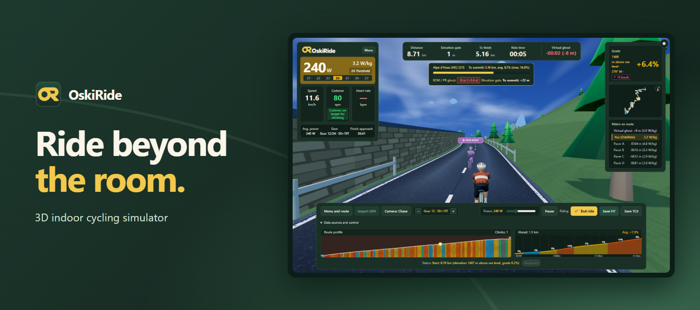
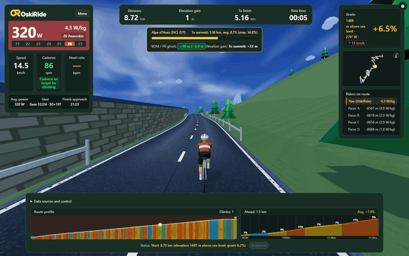
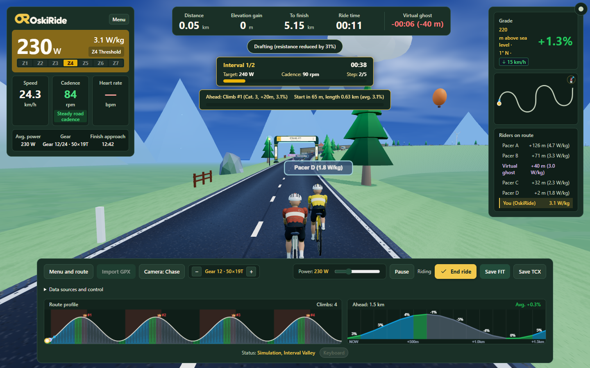
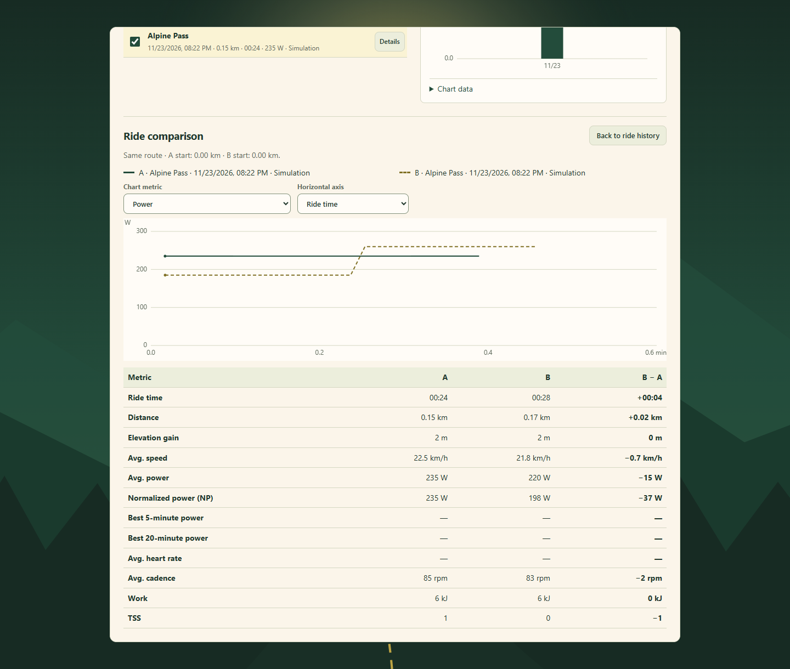

# OskiRide

**[Download for Windows x64](https://github.com/Securityoe/OskiRide/releases/tag/v1.0.1)** · [Watch the ride demo](#ride-demo) · [Screenshot gallery](wiki/en/Screenshots.md) · [Documentation](wiki/en/README.md)

[](wiki/en/Screenshots.md)

Ride GPX routes and structured workouts in 3D with a Bluetooth smart trainer or keyboard-controlled power. OskiRide runs locally and includes virtual shifting, a ride journal, and FIT and TCX exports.

## Ride demo

On Alpe d’Huez, a keyboard-powered rider starts at **0 W**, moves when power is added with the slider, shifts up one gear, and switches from the chase view to the overhead camera.

<details>
<summary>Play the 12-second ride demo</summary>



</details>

[Download the demo video (MP4)](https://github.com/Securityoe/OskiRide/releases/download/v1.0.1/OskiRide-Ride-Demo.mp4)

## Install and start riding

1. Under **Assets**, download the 1.0.1 installer for 64-bit Windows 10 or 11 and its `SHA256SUMS.txt` file. [GitHub Releases](https://github.com/Securityoe/OskiRide/releases/tag/v1.0.1)
2. Verify the SHA-256 hash before opening the installer. Windows may show a SmartScreen warning because the installer is unsigned. [Windows installation and verification](wiki/en/Installation.md#check-the-download-and-windows-smartscreen)
3. Open **Settings** to enter your FTP, body weight, and bike type. Choose a route in **Ride** and select **Start ride**. Keyboard simulation starts at **0 W**. Set your power with **↑ / ↓** or the **Power** slider. To pair equipment, use **Devices**, then check its readings in **Device check**.

### Try a sample GPX

Download the synthetic 4.3 km route, then open **Ride → Import GPX** and select the file. OskiRide previews the elevation and saves the track in **My GPX routes**. Select **Start ride** when ready. [Download the sample GPX](https://github.com/Securityoe/OskiRide/releases/download/v1.0.1/OskiRide-Sample-Alpine.gpx)

## What you can do in OskiRide

| Feature | What it includes |
| --- | --- |
| **Routes** | Five built-in courses, including Alpe d’Huez. GPX import and library, selectable start location, minimap, elevation profile, and climb and turn alerts. |
| **Riding** | Power simulation from 0 W, three bike types, wind, drafting, pacers, a GPX or FTP ghost, and a second ghost based on your saved rides. |
| **Trainers and sensors** | Bluetooth FTMS, Cycling Power, heart rate, and CSC. Protocol support for selected Tacx and Wahoo models, 18 zPower profiles, SIM, ERG, and resistance testing. |
| **Controls** | 24 virtual gears with three gearing profiles. Keyboard and gamepad controls, direct Zwift Click V1/V2 pairing, and a button test. |
| **Workouts** | Five built-in plans, ZWO/MRC/ERG import, power and cadence targets, an interval timer, and automatic selection between SIM and ERG. |
| **Analysis and exports** | NP, IF, TSS, power zones, peak power, a local ride journal, two-ride comparisons, and FIT/TCX export for manual upload. |
| **3D world** | Four rider models, three camera views, three graphics presets, selectable weather and time of day, PBR scenery, tunnels, 12 spectator models, and crowd audio on Alpe d’Huez. |
| **Recovery and logs** | Automatic pause after a trainer disconnect, recovery of interrupted rides, and individual ride logs with JSON export. |

[All features and menu paths](wiki/en/Features.md) · [Hardware compatibility](wiki/en/Equipment.md#hardware-compatibility) · [Privacy and ride data](wiki/en/Privacy.md)

## Ride, train, and review

| Follow an interval | Compare two rides |
| --- | --- |
| [](wiki/en/Screenshots.md#workout-in-progress) | [](wiki/en/Screenshots.md#after-the-ride) |

- **Your routes.** **Ride → My GPX routes** lets you search, rename, favorite, and revisit saved GPX tracks. Importing identical contents keeps the existing entry. Open **Ride history** to see previous rides on that route. [Routes and graphics](wiki/en/Routes-and-Graphics.md)
- **Your workouts.** Importing a workout selects the plan. The session starts when you select **Start ride** or **Start workout**, and ride totals advance while you are moving. Pausing stops the counters and interval timer, cancels active ERG commands, and requests neutral resistance on a controlled trainer. Resuming restores the selected control mode. [Workouts and journal](wiki/en/Workouts-and-Journal.md)
- **Your progress.** In **Journal**, filter rides by route or date and group totals by week or month. Select two rides for a side-by-side comparison of power, heart rate, cadence, speed, or elevation. Saved history lives in IndexedDB, and available entries from older versions appear when the journal is opened. [Workouts and journal](wiki/en/Workouts-and-Journal.md)
- **Your ride data.** OskiRide stores your rider profile and selected preferences locally. The pre-ride screen shows the route, profile, plan, and where readings come from. Active rides periodically save a checkpoint so that you can restore an interrupted ride in pause. Storage errors are shown in the interface. [Recovery and troubleshooting](wiki/en/Troubleshooting.md)

## Equipment and graphics

- **Bluetooth devices.** Pair a trainer, power meter, heart rate monitor, or speed and cadence sensor in **Devices**. **Device check** offers a 30-second readings check and a separate 5-second resistance test. SIM and ERG behavior depends on the hardware. Reconnecting a dropped trainer leaves the ride paused until you select **Resume ride**. [Equipment and controls](wiki/en/Equipment.md)
- **Zwift Click.** Pair left and right V2 controllers separately. **+** shifts to a harder gear and **−** to an easier one. Use **Test buttons** to see which button was pressed. On Click V2, **Z** toggles the menu, the left arrows move the selection, and **B** confirms it by default. The HUD shows available battery readings and relevant alerts. [Pairing, mappings, and gamepad controls](wiki/en/Equipment.md#zwift-click-keyboard-and-gamepad)
- **Ride diagnostics.** The connection indicator shows whether the trainer is disconnected, connecting, connected, or has dropped. It opens **Devices**. **Settings → Logs** shows activity-specific events and can export a JSON report. [Troubleshooting and logs](wiki/en/Troubleshooting.md)
- **3D presentation.** Compare four riders in Rider Studio. While riding, choose a chase, handlebar, or overhead camera. Adaptive graphics can reduce scenery range and shadows during sustained frame-rate drops. Alpe d’Huez has crowd audio near bend 7. [Routes and graphics](wiki/en/Routes-and-Graphics.md)

## Run from source

Install Node.js 24 LTS. Use a WebGL-compatible browser such as Chrome or Edge. Bluetooth requires Web Bluetooth support, an available adapter, and system permissions.

```powershell
node server.js
```

[Open the local ride view](http://localhost:8080/index.html) · [Open the local Rider Studio](http://localhost:8080/grafika/index.html)

To open the Electron app, run:

```powershell
npm ci
npm run desktop
```

`npm run build:win` builds the Windows x64 installer in `dist/`. The project also has a `npm run build:mac` target. The public 1.0.1 installer is for Windows. [Source setup and build details](wiki/en/Installation.md)

## Testing and project resources

- Run `npm run test:consistency` after installing the `tools/3d` dependencies. The suite uses Microsoft Edge and BLE test doubles. Hardware pairing and resistance response require a device test. [Regression tests and architecture](wiki/en/Troubleshooting.md)
- A GPX performance check measured about 60 FPS in six locations across three graphics presets on Intel Iris Xe at 1366×768 and DPR 1. Dense scenery exceeded the draw-call budget. Longer rides and higher resolutions need separate measurements. [Technical documentation](docs/DOKUMENTACJA_TECHNICZNA.md)
- `src/` contains the ride loop, Bluetooth, GPX processing, physics, training, and exports. `tools/3d/` includes Blender helpers and validators. [Source map](wiki/en/Troubleshooting.md#where-the-code-lives)
- The project’s visual identity is **Sun and Forest**, with the OR logo, sunny yellow, and forest green. The repository contains editable Blender assets and models for 3D printing the logo. [3D and brand assets](grafika/README.md)
- The project changelog records development history. [Release notes](https://github.com/Securityoe/OskiRide/releases/tag/v1.0.1) · [Project changelog](CHANGELOG.md)
