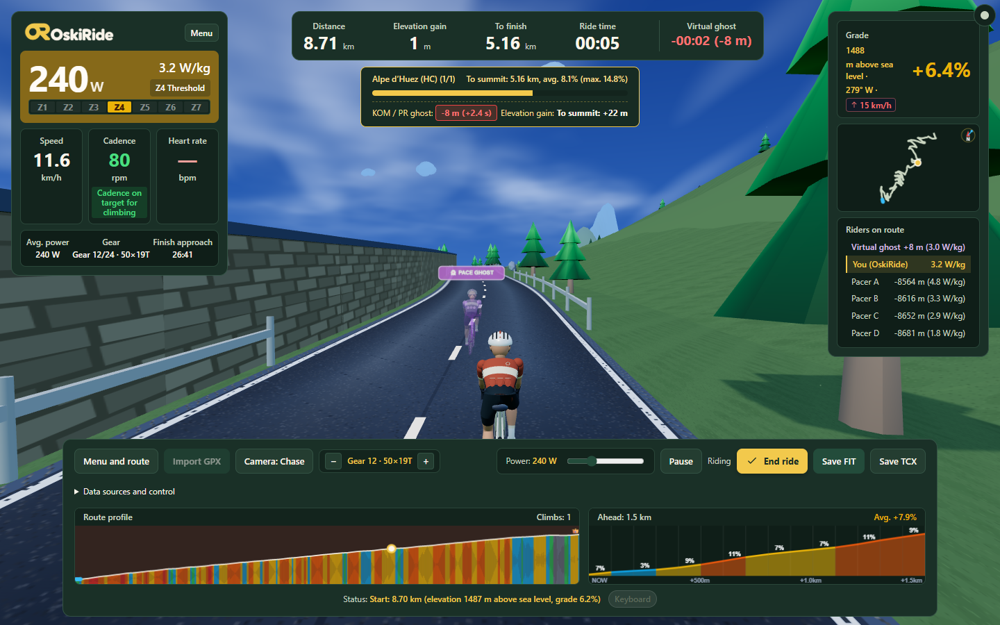
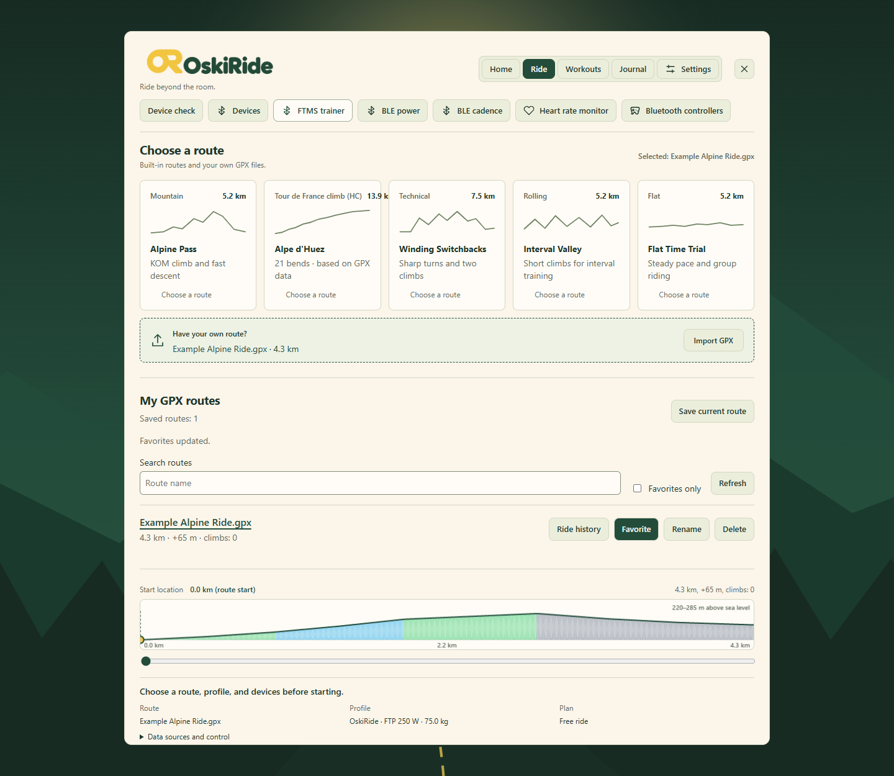
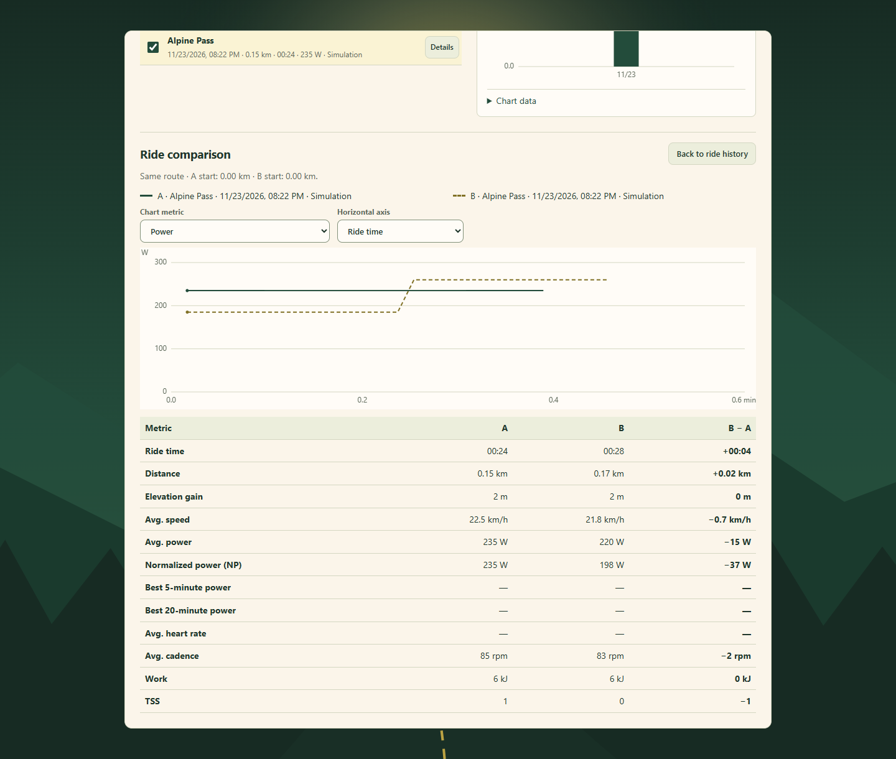

# OskiRide 1.0.1 for Windows

**Ride beyond the room.**

OskiRide is a 3D indoor cycling simulator for Windows. Ride a built-in route, import your own GPX file, or follow a structured workout. Pair your Bluetooth smart trainer or try a ride with keyboard-controlled power.

**[Download OskiRide for Windows x64](https://github.com/OskiOski89/OskiRide/releases/download/v1.0.1/OskiRide-Setup-1.0.1-x64.exe)** · [SHA-256 checksum file](https://github.com/OskiOski89/OskiRide/releases/download/v1.0.1/SHA256SUMS.txt) · [Ride demo](https://github.com/OskiOski89/OskiRide#ride-demo)



*Alpe d’Huez with the pace ghost and the climb profile in view.*

## Download and ride

1. Save `OskiRide-Setup-1.0.1-x64.exe` and `SHA256SUMS.txt` from **Assets** in the same folder. The installer supports 64-bit Windows 10 and 11.
2. [Verify the download](#check-the-download-and-windows-smartscreen), then run the installer and launch **OskiRide** from the Start menu.
3. Open **Ride**, choose a route, and select **Start ride**. Without a power device, you start at **0 W**. Press **↑** or move the power slider to get moving. To pair a trainer, power meter, cadence sensor, heart rate monitor, or Zwift Click, open **Devices**.

To try GPX import, download `OskiRide-Sample-Alpine.gpx`, then select it in **Ride → Import GPX**. The synthetic 4.3 km course appears in **My GPX routes**. [Download the sample GPX](https://github.com/OskiOski89/OskiRide/releases/download/v1.0.1/OskiRide-Sample-Alpine.gpx)

## Check the download and Windows SmartScreen

The Windows installer for v1.0.1 is unsigned. Microsoft Defender SmartScreen may show a warning when you open it. Download the installer and checksum from the **Assets** section on this release page. [How Windows SmartScreen works](https://learn.microsoft.com/en-us/windows/apps/package-and-deploy/smartscreen-reputation)

Open PowerShell in the folder containing both files and run these commands.

```powershell
(Get-FileHash -Algorithm SHA256 -LiteralPath .\OskiRide-Setup-1.0.1-x64.exe).Hash
Get-Content -LiteralPath .\SHA256SUMS.txt
```

Compare the first result with the hash before the installer filename. Letter case does not matter. A match confirms that your file has the same contents as the installer published with this release. If the hashes differ, leave the installer unopened and download both files again from this page. [PowerShell checksum documentation](https://learn.microsoft.com/en-us/powershell/module/microsoft.powershell.utility/get-filehash)

## Security and privacy

- The source server listens on loopback and serves a restricted set of application and preview assets.
- The desktop app restricts navigation and Bluetooth selection to the views that use them. It blocks web requests from the app window and opens the Strava upload page in the system browser.
- The packaged app verifies the integrity of its Electron archive.
- Profiles, routes, and ride history stay on your device. Activity exports and diagnostic logs can contain personal training or device data. [Privacy and ride data](https://github.com/OskiOski89/OskiRide/blob/main/wiki/en/Privacy.md)

## Screenshots

| Choose a route | Compare your rides |
| :--- | :--- |
| <a href="https://github.com/OskiOski89/OskiRide/blob/main/wiki/en/Screenshots.md#route-selection-and-gpx-library"></a> | <a href="https://github.com/OskiOski89/OskiRide/blob/main/wiki/en/Screenshots.md#after-the-ride"></a> |
| Pick a built-in course or import a GPX file in **Ride**. | Use **Journal** to compare power and other metrics across two saved rides. |

The gallery includes Bluetooth pairing, riding in the rain, the workout library, an active interval, the ride summary, and Rider Studio. [Explore all nine screenshots](https://github.com/OskiOski89/OskiRide/blob/main/wiki/en/Screenshots.md) · [Workout in progress](https://github.com/OskiOski89/OskiRide/blob/main/wiki/en/Screenshots.md#workout-in-progress)

Watch OskiRide start from **0 W**, shift up a virtual gear, and switch to the overhead camera on Alpe d’Huez. [Watch the ride demo in the README](https://github.com/OskiOski89/OskiRide#ride-demo) · [Download the MP4](https://github.com/OskiOski89/OskiRide/releases/download/v1.0.1/OskiRide-Ride-Demo.mp4)

## What you can do in OskiRide

| Feature | What you can do |
| :--- | :--- |
| **Routes and pacing** | Ride five built-in courses or import and organize GPX files. Pick a starting point and follow the minimap, elevation profiles, and climb and turn alerts. Choose a bike, enter your weight and FTP, draft behind pacers, and race a GPX or FTP ghost alongside a personal-best effort. |
| **Bluetooth and controls** | Pair Bluetooth FTMS trainers, power meters, speed and cadence sensors, heart-rate monitors, and Zwift Click V1 or V2. Use 18 zPower curves, spindown, and pre-ride checks. Shift through 24 virtual gears across three gearing profiles with a keyboard, gamepad, or Zwift Click. Click V2 supports menu navigation, button mapping, and input testing. |
| **Structured workouts** | Choose from five plans or import ZWO, MRC, or ERG files. Follow the active interval, power target, and cadence target when specified. Supported trainers can follow the route grade in SIM or hold target power in ERG. |
| **Journal and exports** | Review power zones, NP, IF, TSS, peak power, and ride telemetry. Filter your local journal, view weekly or monthly trends, compare two rides, and export FIT or TCX files for manual upload to Strava or another service. |
| **3D ride settings** | Choose among four rider models, three cameras, graphics presets, weather, road appearance, and time of day. Adaptive graphics can adjust scenery and shadows. Alpe d’Huez has crowd audio near bend 7. |
| **Recovery and diagnostics** | Restore a saved ride in pause, resume manually after a trainer disconnect, and download JSON logs for individual rides. |

Bluetooth compatibility and resistance response depend on your equipment. The compatibility table shows what each protocol can do and how it was verified. The interface is primarily in English. [Complete feature guide](https://github.com/OskiOski89/OskiRide/blob/main/wiki/en/Features.md) · [Hardware compatibility table](https://github.com/OskiOski89/OskiRide/blob/main/wiki/en/Equipment.md#hardware-compatibility)

## Help

Use the installation and troubleshooting guides for Windows setup, pairing, and ride recovery. [Installation and first ride](https://github.com/OskiOski89/OskiRide/blob/main/wiki/en/Installation.md) · [Troubleshooting](https://github.com/OskiOski89/OskiRide/blob/main/wiki/en/Troubleshooting.md)

For help, include your Windows version, device model, and steps to reproduce the issue. [Report an issue](https://github.com/OskiOski89/OskiRide/issues)
