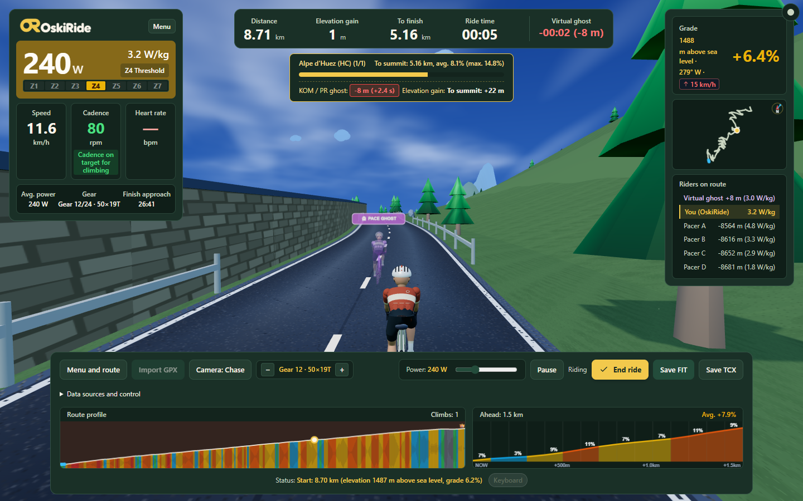
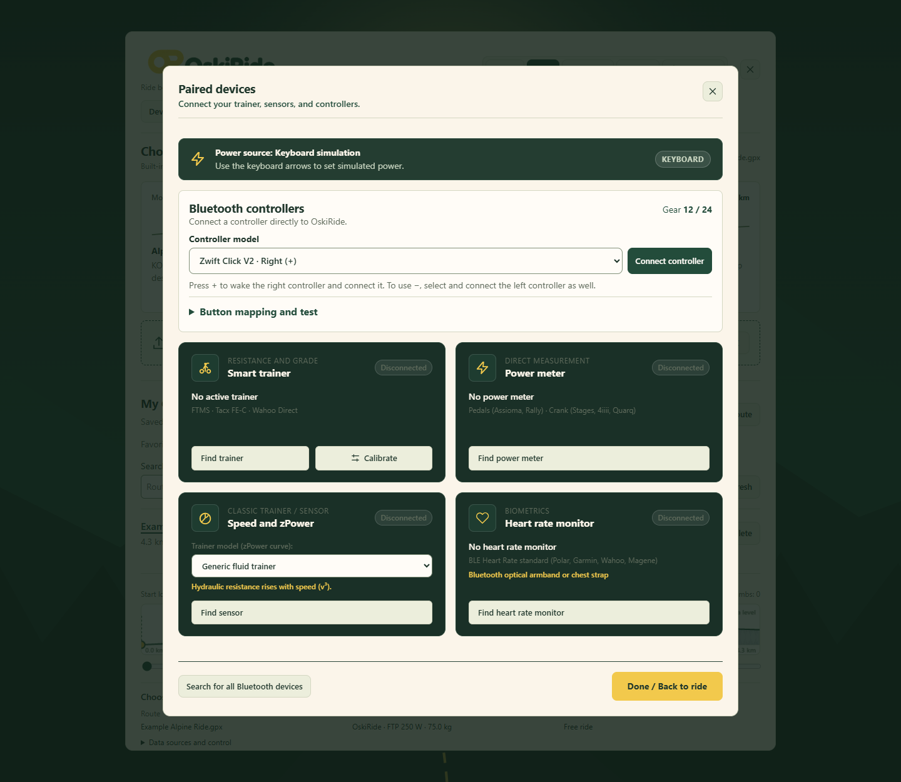
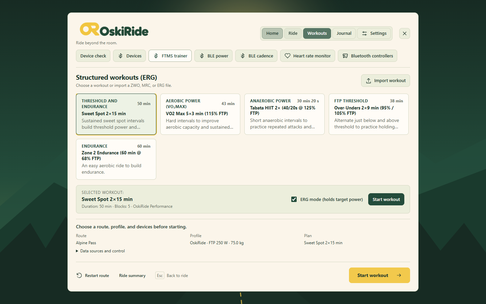
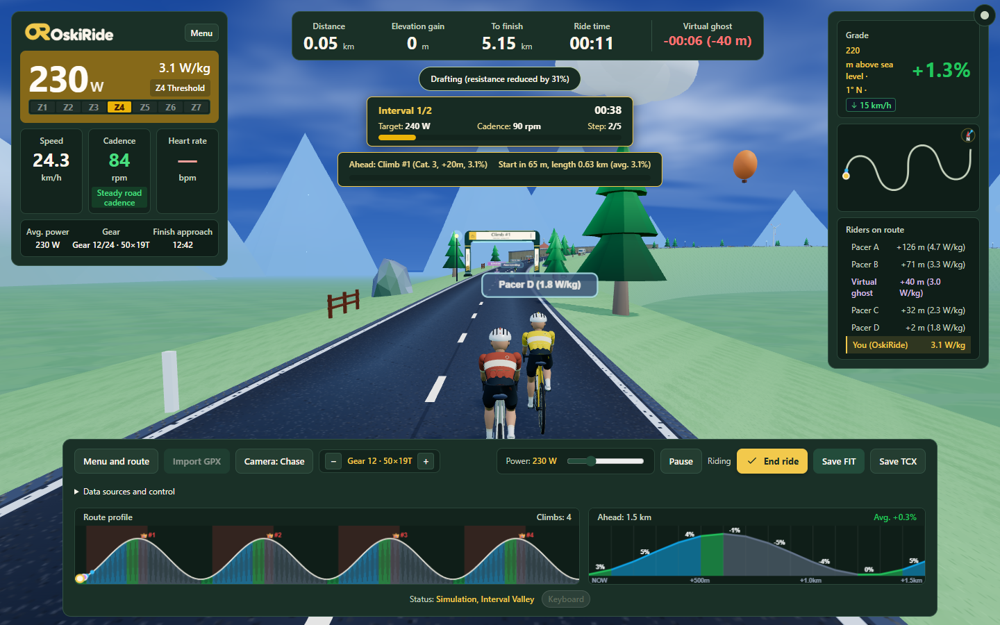

# OskiRide screenshots

Follow a ride from route and equipment setup through the live interval display and journal. Select any image for a closer look. Captured in OskiRide 1.0.0 using keyboard power and demonstration data.

[Routes and weather](#route-selection-and-gpx-library) · [Devices and workout library](#prepare-for-a-ride) · [Live interval](#workout-in-progress) · [Ride analysis](#after-the-ride) · [Rider Studio](#rider-studio)

## Riding Alpe d’Huez

The chase camera keeps the pace ghost and the road ahead in view. The HUD shows live telemetry, the minimap, climb progress, and upcoming grades. [Watch the ride demo](../../README.md#ride-demo)

## Route selection and GPX library

| Choose or import a route | Alpine Pass in the rain |
| --- | --- |
|  |  |
| In **Ride**, choose from five built-in courses or select **Import GPX**. Use the elevation profile to pick your start point. [Try the sample GPX](Installation.md#try-a-sample-gpx) | Select **Settings → Weather and road surface → Rain (wet road)**. Power, speed, gradient, and virtual gear stay visible as you ride. |

## Prepare for a ride

| Bluetooth devices | Workout library |
| --- | --- |
|  |  |
| Open **Devices** to connect a smart trainer, power meter, speed or cadence sensor, heart rate monitor, or Zwift Click. The screenshot shows keyboard simulation selected before pairing. | Pick one of five built-in plans or import a ZWO, MRC, or ERG file. [Set up a structured workout](Workouts-and-Journal.md#structured-workouts) |

## Workout in progress

The interval card shows the active step, time left, and targets from the imported ZWO plan. Here the rider has **38 seconds** left and is riding at **230 W** and **84 rpm**, against targets of **240 W** and **90 rpm**.

## After the ride

| Ride summary | Compare saved rides |
| --- | --- |
|  |  |
| Select **End ride** to review distance, time, elevation gain, training load, power zones, and the power-duration curve. | In **Journal**, select two saved rides and choose **Compare rides**. The chart plots power over time, and the table shows the difference for each metric. |

## Rider Studio

Compare the four rider models and preview their poses and cadence before choosing one.

[Complete feature guide](Features.md) · [Download for Windows x64](https://github.com/Securityoe/OskiRide/releases/tag/v1.0.1)
