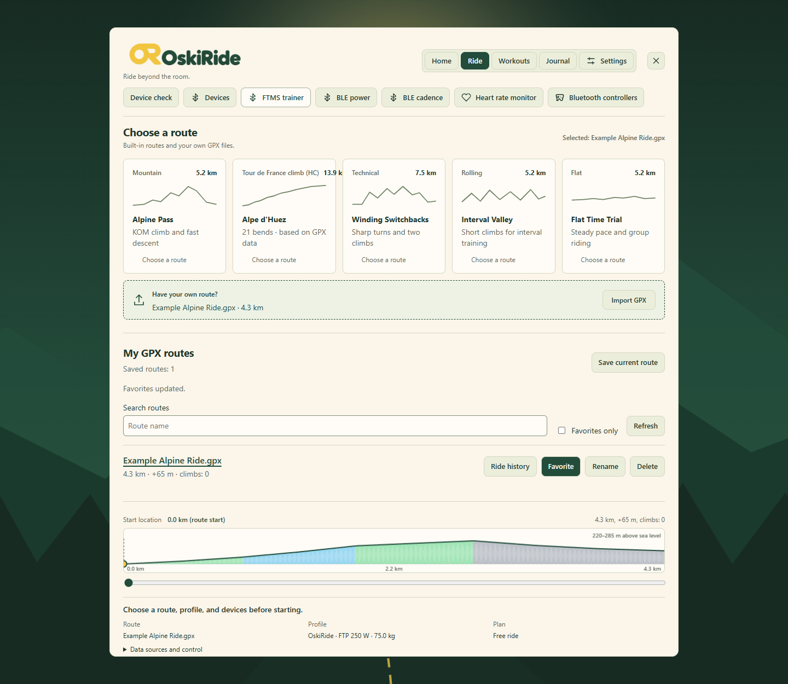
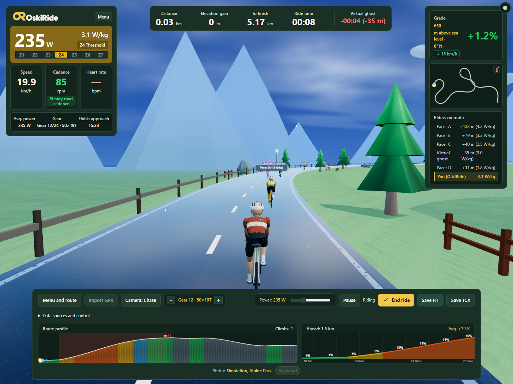
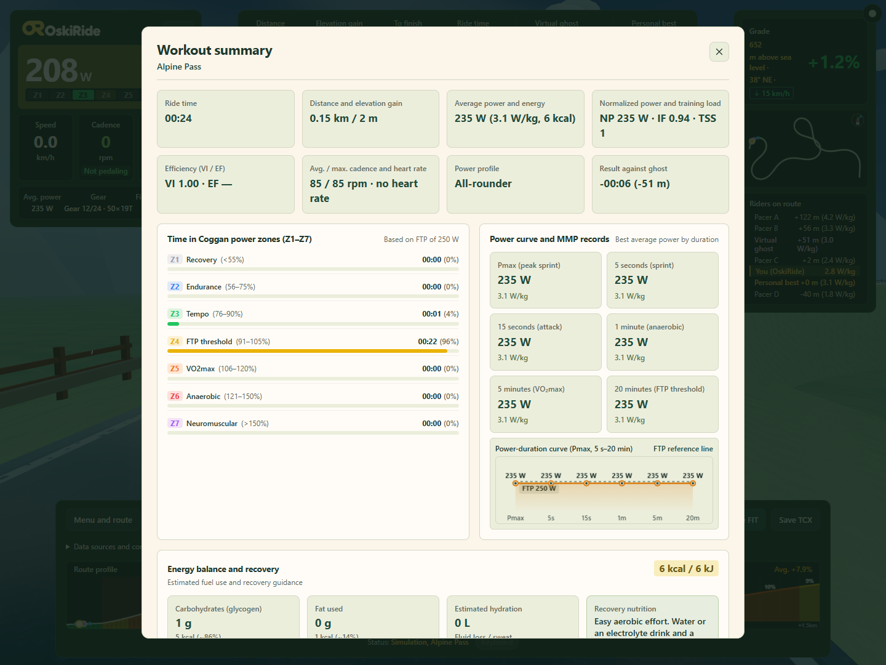
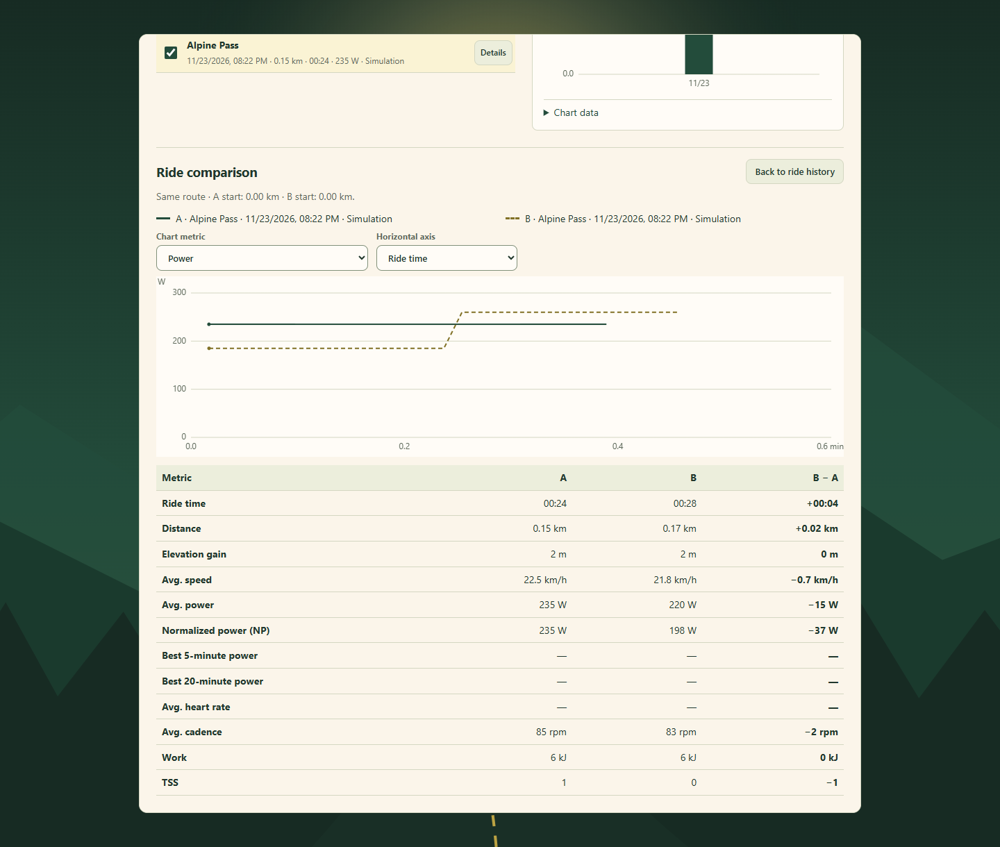
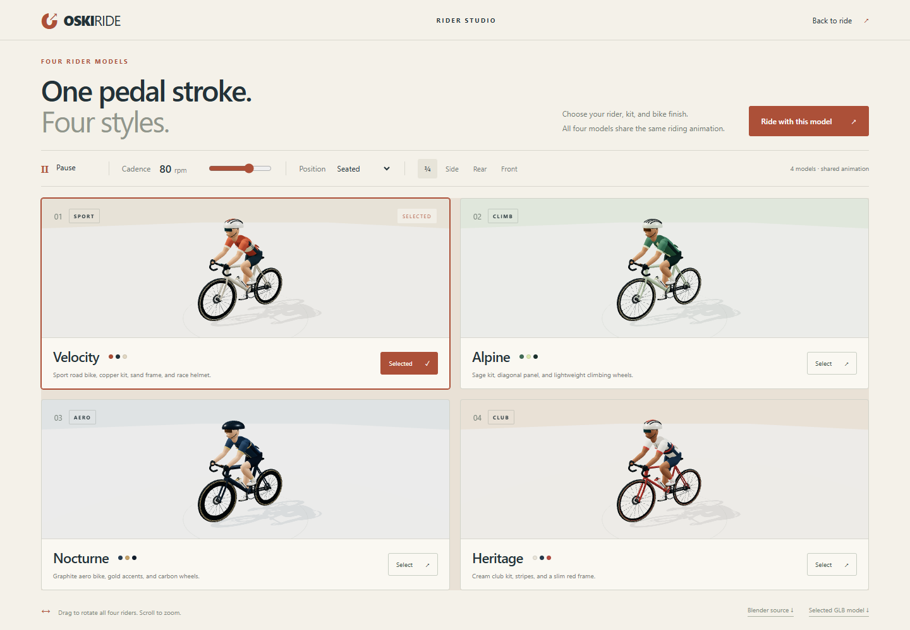

# OskiRide screenshots

These screenshots show OskiRide 1.0.0. The ride, workout, and journal values come from demonstrations using keyboard power. [Windows release](https://github.com/Securityoe/OskiRide/releases/tag/v1.0.1) · [Ride demo](../../README.md#ride-demo) · [Complete feature guide](Features.md)

## Riding Alpe d’Huez

The chase view shows the pace ghost, rider telemetry, minimap, climb progress, and the grade profile ahead.

## Route selection and GPX library

Open **Ride** to choose from five built-in courses. Select **Import GPX** to load a file such as the example Alpine ride shown here. Use the library to find saved routes and the elevation profile to choose where to start. [Download and try the same GPX track](Installation.md#try-a-sample-gpx)

## Bluetooth devices

Open **Devices** to pair a smart trainer, power meter, speed or cadence sensor, heart rate monitor, or Zwift Click. This screen shows the controls before pairing, with keyboard simulation selected as the power source.

## Alpine Pass in the rain

Choose **Rain (wet road)** under **Settings → Weather and road surface**. This chase view shows the wet road, pacers ahead, and live power, speed, gradient, and virtual gear.

## Workout library

Choose from the five built-in workouts or import your own plan in ZWO, MRC, or ERG format.

## Workout in progress

During an interval, the workout card shows the target power, time remaining, and current step. This example has **38 seconds** left, a **240 W** power target, and a **90 rpm** cadence target. Compare those targets with the live **230 W** and **84 rpm** in the upper-left panel. The workout uses an imported ZWO plan and keyboard power. [Load and start a workout](Workouts-and-Journal.md#structured-workouts)

## Ride summary

Select **End ride** to review distance, time, elevation gain, and power for the session. The summary shows the training load, time spent in each power zone, and the power-duration curve.

## Comparing rides in the journal

Open **Journal**, check two saved rides, and select **Compare rides**. Here the chart plots power against elapsed ride time for two simulated sessions on Alpine Pass. The table gives a side-by-side breakdown with the difference for each metric.

## Rider Studio

Compare the Velocity, Alpine, Nocturne, and Heritage riders and preview their poses and cadence before choosing a model.

